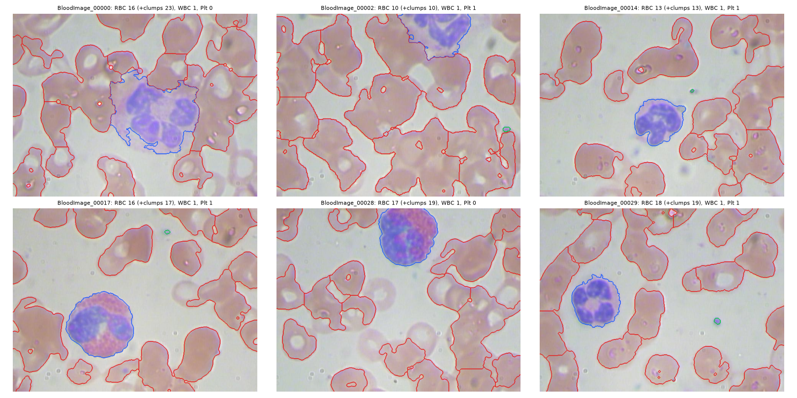

# Blood Cell Detection & Analysis

Segmentation, separation, classification, counting and measurement of blood cells
in microscopic smear images, using mathematical morphology (top-hat, granulometry,
opening/closing, reconstruction, distance transform, marker-controlled watershed, SKIZ)
and a light ML classifier.

Course project: *Morphologie mathématique et application médicale* (ENSI).
Full specification: [project.md](project.md).

> **Educational prototype, not a medical device.**



## How it works

| Stage | Morphology |
| ----- | ---------- |
| Scale | Granulometry (pattern spectrum of openings by disks) gives the RBC radius `r`; every parameter is a multiple of `r`, so the pipeline works at any magnification |
| Preprocessing | Green channel, median filter, relative black top-hat (closing by a disk of 2.5 r = background), purple-stain channel −b\* |
| Segmentation | Otsu thresholds, **shape-filtered hole fill** (only small, round, convex holes = RBC pale centres), opening, closing, small-object removal |
| WBC | Nucleus = large purple components (lobes grouped by a closing); whole cell = **watershed of the morphological gradient** seeded from the nucleus; N/C ratio |
| Platelets | Small purple components; specks **enclosed** in an RBC are rejected (ring measurement) |
| RBC splitting | **Distance transform + h-maxima markers + watershed** on the RBC mask (WBCs and platelets removed first) |
| Contours | Morphological gradient of the **label map** (shows the split lines) |
| Classification | Rule baseline vs logistic regression / SVM / random forest on scale-free features (GroupKFold by microscope field) |
| Anomalies | Robust z-score of RBC size / circularity, clumps estimated by area, RBC area CV (anisocytosis) |

## Results

Official BCCD split with same-field leakage removed (train 209 / val 78 / **test 72**, test set
evaluated once, after all tuning on train/val). Detection = one-to-one box matching at IoU ≥ 0.5.

| Class | Val P / R / F1 | **Test P / R / F1** | Test count MAE / image |
| ----- | -------------- | ------------------- | ---------------------- |
| WBC | 0.99 / 0.99 / 0.99 | **0.83 / 0.97 / 0.90** | 0.17 |
| Platelet | 0.63 / 0.73 / 0.68 | **0.63 / 0.67 / 0.65** | 0.53 |
| RBC | 0.41* / 0.60 / 0.49 | **0.38* / 0.59 / 0.47** | 7.5* |

\* BCCD leaves ~30 % of the RBCs without a box: RBC precision and count error are measured
against an incomplete reference (lower bound / upper bound); RBC recall is not affected
(0.76 at IoU ≥ 0.3).

| Ablation (test, RBC recall@0.5 / WBC F1@0.5) | |
| --- | --- |
| A Otsu + connected components | 0.37 / 0.61 (RBC count ×5.3) |
| D + top-hat, shape hole fill, opening/closing | 0.39 / 0.68 |
| E + distance transform + watershed | 0.59 / 0.83 |
| F + WBC segmented first (full) | 0.59 / 0.90 |

- **Classification** of the detected objects (random forest, gated by the pipeline branch):
  macro-F1 0.989 [95 % CI 0.970, 1.000] on test (rule baseline 0.976 on val).
- **Scale**: granulometric `r` within 15 % of the box radius on 91 % of val images; zoom ×0.5 /
  ×2: r follows the zoom (median ratio 1.00), RBC F1 0.54 at ×0.5, ×1 and ×2 on val
  (fixed-pixel parameters: 0.42 at ×2).
- **Other microscope / stain** (Raabin-WBC, 720 crops): the WBC at the crop centre is found in 90 %.
- **Runtime**: 1.6 s per 640×480 image on a laptop CPU.

Full tables: `results/tables/eval_{val,test}_*`; logs: `results/tables/eval_*_log.txt`.
Pixel Dice / IoU will be added once the manual masks exist (see `docs/manual_tasks.md`).
Report draft: [docs/report/report.md](docs/report/report.md); slides: [docs/slides/slides.md](docs/slides/slides.md).

## Install

```bash
python -m venv .venv
# Windows: .venv\Scripts\activate    Linux/macOS: source .venv/bin/activate
pip install -r requirements.txt
pip install -e .
```

(or `make setup`; `make help` lists every command).

## Quick start

```bash
python scripts/run_pipeline.py data/raw/BCCD_Dataset/BCCD/JPEGImages/BloodImage_00014.jpg
python scripts/export_steps.py --ids BloodImage_00014  # one image per step in outputs/NN-step/
python scripts/run_pipeline.py path/to/folder --ids    # batch: overlays, per-cell CSVs, summary.csv
```

```python
from bloodcells.config import load_config
from bloodcells.io_utils import load_image
from bloodcells.pipeline import run

res = run(load_image("path/to/smear.jpg"), load_config())
res.counts            # {'RBC': .., 'WBC': .., 'Platelet': .., 'RBC_with_clumps': ..}
res.features          # one row per cell: area, circularity, N/C, anomaly, ...
res.overlay()         # RGB image with class-coloured contours
```

## Reproduce the results

```bash
python scripts/download_data.py        # BCCD (GitHub); Raabin-WBC + ALL-IDB need a Kaggle token
python scripts/build_index.py          # annotations -> data/index/*.csv
python scripts/make_splits.py          # official BCCD split without same-field leakage
python scripts/check_scale.py          # granulometry r vs boxes + zoom check
python scripts/build_features.py       # pipeline on every image -> data/features/
python scripts/train_classifier.py     # model selection (GroupKFold) -> models/classifier.joblib
python scripts/run_evaluation.py --split val --ablation
python scripts/run_evaluation.py --split test --ablation   # final, run once
```

Notebooks: `01_data_exploration`, `02_preprocessing_and_scale`, `03_pipeline_step_by_step`
(`make pipeline-nb`; the `.py` file is the jupytext source).

| Dataset    | Role                                   | Source                                                            | License / terms            |
| ---------- | -------------------------------------- | ----------------------------------------------------------------- | -------------------------- |
| BCCD       | Main: counting, detection, classes     | https://github.com/Shenggan/BCCD_Dataset                          | MIT                        |
| Raabin-WBC | WBC nucleus/cytoplasm Dice (stretch)   | https://www.kaggle.com/datasets/raabindata/raabin-wbc             | see dataset page           |
| ALL-IDB    | Blast detection (stretch)              | https://www.kaggle.com/datasets/sizlingdhairya1/all-idb-images (mirror) | no redistribution; cite Labati et al., 2011 |

Kaggle token: create one at https://www.kaggle.com/settings and save `kaggle.json`
to `~/.kaggle/` (Windows: `C:\Users\<you>\.kaggle\`).

## Project structure

```
config.yaml            every parameter (sizes in units of r)
src/bloodcells/        preprocessing, scale, segmentation, wbc, platelets, separation,
                       features, classifier, anomaly, pipeline, evaluate, visualization
scripts/               data, features, training, evaluation and batch CLI
outputs/               every pipeline step as images (make outputs; regenerated)
docs/                  report draft (report/), slides (slides/), state of the art,
                       manual_tasks.md (what is left to do by hand)
notebooks/             exploration, preprocessing, pipeline step by step
tests/                 pytest (synthetic images with known ground truth)
```

## Limitations

- BCCD has boxes, not masks, and misses many RBC (and some WBC) boxes: precision and count
  errors are measured against an incomplete reference. Pixel Dice needs the 18 manual masks;
  drafts and tools are ready (`python scripts/annotate.py next`, see `docs/manual_tasks.md`).
- The granulometric scale fails on ~5 % of the images (ring-shaped RBCs, sparse fields).
- Heavily overlapping RBCs are sometimes left as a clump (flagged, counted by area).
- One stain / microscope (BCCD); other stains may need a different purple channel.

## Tests

```bash
pytest          # or: make check   (flake8 + black + pytest)
```

## Authors

Wael Kacem, Talel Ben Mbarek. Code: MIT license.
