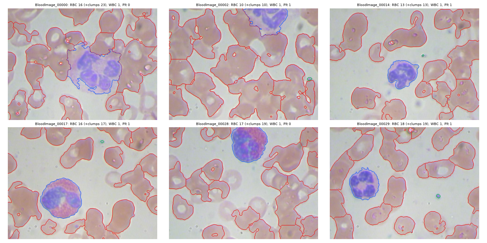
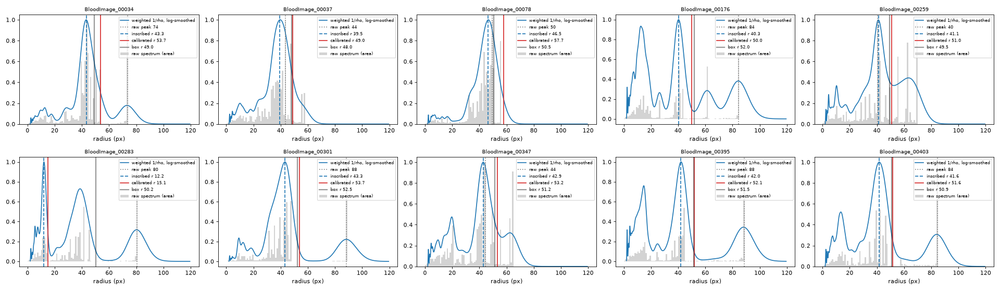
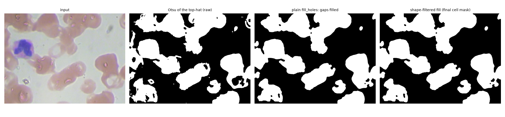
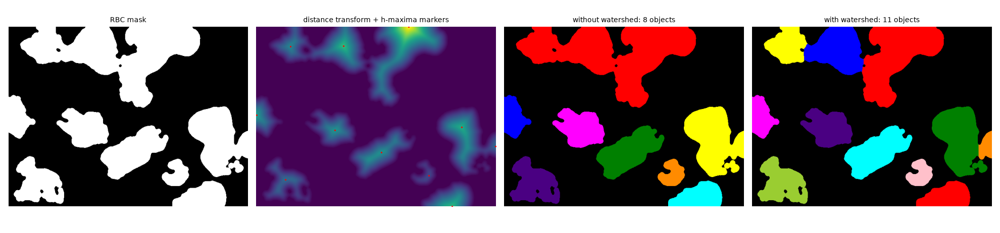
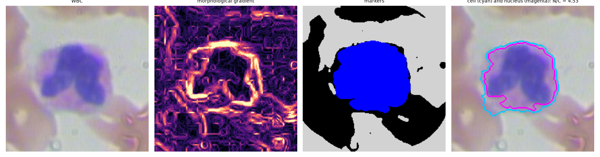

<!-- Export: npx @marp-team/marp-cli docs/slides/slides.md --pdf --allow-local-files
     (or --pptx). Image paths are relative to this file. -->

# Blood cell detection & analysis
## with mathematical morphology

Wael Kacem, Talel Ben Mbarek
Morphologie mathématique et application médicale, ENSI

---

# Problem

- Blood smear: RBCs (count, size), WBCs (count, N/C ratio), platelets (count)
- Manual counting: slow, operator-dependent; **cells touch and overlap**
- Goal: segment, **split touching cells**, classify, count, measure, flag anomalies
- Data: **BCCD** (364 images, boxes only; ~30 % of RBCs unboxed), official split
  without same-field leakage: 209 / 78 / **72 test**

---

# Pipeline (all sizes in units of the RBC radius r)

1. **Granulometry** (pattern spectrum of openings) → r of each image
2. Green channel, median, **relative black top-hat** (closing 2.5 r)
3. Otsu + **shape-filtered hole fill** + opening / closing
4. **WBC first**: nucleus (closing groups lobes) + **gradient watershed**
5. Platelets: small stained components, **enclosure filter**
6. RBCs: **distance transform + h-maxima + watershed**
7. Contours = **gradient of the label map**; random forest decides the class

40 inspectable steps: `outputs/01-original … 40-anomalies`

---

# Granulometry: scale-free parameters

- r within 15 % of the box radius on **91 %** of val images
- zoom ×0.5 … ×2: r follows the zoom (median ratio **1.00**)

---

# Shape-filtered hole fill

Fill only **small, round, convex** holes (RBC pale centres), never the concave gaps
between touching cells.

---

# Splitting touching RBCs

h-maxima of the distance (h = 0.15 r) as markers → watershed of −distance

---

# WBC: gradient watershed from the nucleus

Markers: nucleus (grown past its edge), background, touching RBCs → cytoplasm, **N/C ratio**

---

# Results (test set, evaluated once)

| | P | R | F1 @ IoU 0.5 |
|---|---|---|---|
| WBC | 0.83* | 0.97 | **0.90** |
| Platelet | 0.63 | 0.67 | **0.65** |
| RBC | 0.38* | 0.59 | 0.47 (R@0.3 = 0.76) |

\* lower bounds: BCCD misses ~30 % of RBC boxes and some WBC boxes
Classification macro-F1 **0.989**; **1.6 s** / image (laptop CPU)

---

# Ablation (test)

| | RBC recall | WBC F1 |
|---|---|---|
| A Otsu + components | 0.37 (count ×5.3) | 0.61 |
| D + top-hat, hole fill, opening / closing | 0.39 | 0.68 |
| E + distance + watershed | **0.59** | 0.83 |
| F + WBC first (full) | 0.59 | **0.90** |

Each operator has a measurable role; magnification ×0.5 / ×2: RBC F1 unchanged (0.54)

---

# Limits & future work

- Granulometry fails on ~5 % of images (ring-shaped RBCs, sparse fields)
- Box-only reference → pixel Dice on 18 manual masks (in progress)
- Heavy overlaps left as clumps (counted by area)
- Next: robust multi-peak scale, Cellpose / YOLO comparison, other stains

**Demo**: `python scripts/export_steps.py --ids BloodImage_00014`
